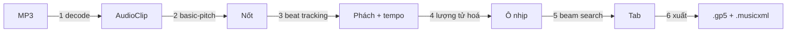

# lamnhac

**Chuyển một file MP3 guitar solo thành tab Guitar Pro.** Kết quả gồm file `.gp5` để mở thẳng trong Guitar Pro và file MusicXML có khuông tab. Tool chạy hoàn toàn offline trên máy của bạn.

```powershell
uv sync
uv run lamnhac convert "D:\nhac\bai.mp3"
# -> D:\nhac\bai.gp5 và D:\nhac\bai.musicxml
```

Kết quả là **bản nháp** để bạn mở trong Guitar Pro 8 rồi sửa tiếp, không phải bản chép hoàn chỉnh.

<div class="grid cards" markdown>

- :material-waveform: **Nhận nốt đa âm**

    Dùng model basic-pitch của Spotify, nhận được cả hợp âm. Chạy trên CPU, không cần GPU, không cần mạng.

- :material-metronome: **Bám theo nhịp thật**

    Lưới ô nhịp nội suy theo từng phách, nên khi người chơi nhanh hay chậm dần thì nốt vẫn rơi đúng ô.

- :material-guitar-electric: **Tab dễ chơi**

    Beam search chọn thế bấm ít di chuyển tay. Hỗ trợ tuning khác chuẩn (Drop D…) và giới hạn vùng phím.

- :material-file-music: **Guitar Pro 8 và MusicXML**

    Xuất `.gp5` (GP 5.1) và MusicXML có khuông TAB và tuning, nên mở được bằng Guitar Pro hoặc MuseScore.

</div>

## Bắt đầu

- [Hướng dẫn](guide.md): cài đặt, các tuỳ chọn, ví dụ, mã thoát, giới hạn.
- [Thuật toán](algorithms.md): cách từng bước hoạt động và vì sao chọn cách đó.
- [Thiết kế](prd/PRD-mp3-to-guitarpro.md): PRD, spec, sequence diagram, ADR.

## Pipeline


