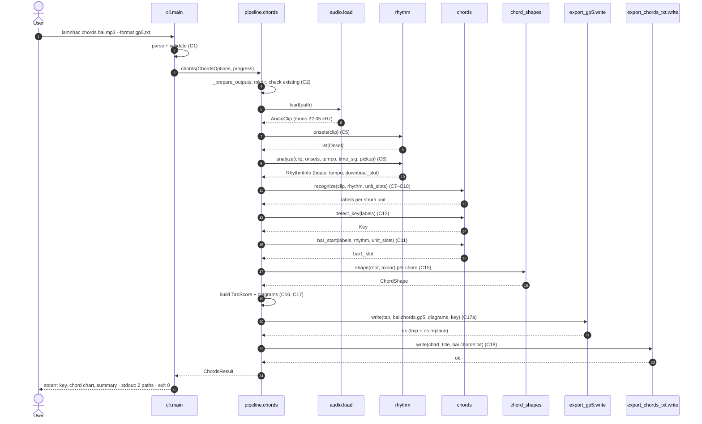
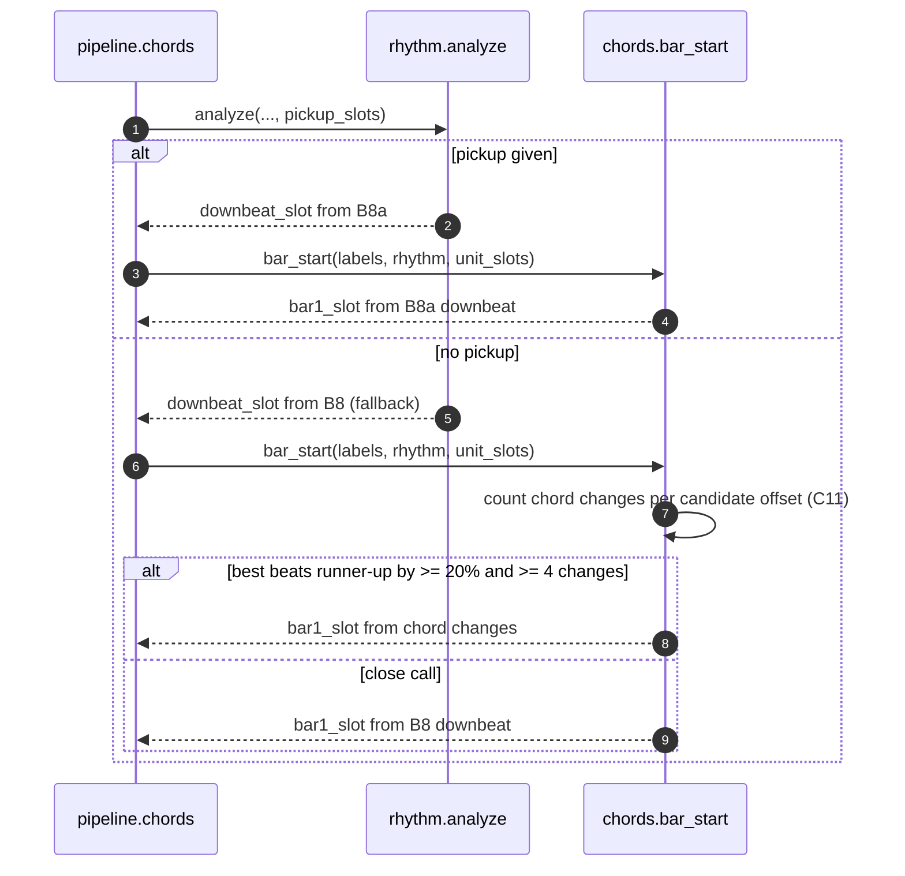
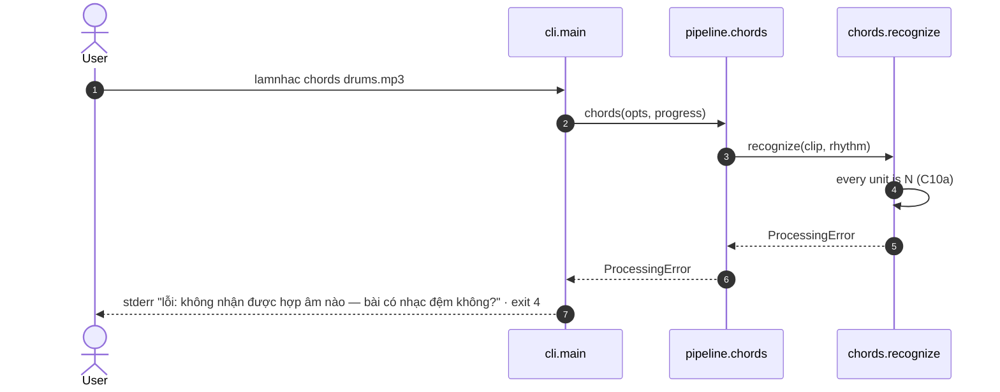
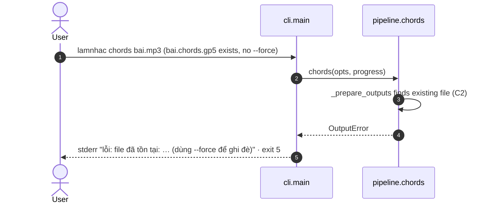

# Sequence Diagrams: Vòng hợp âm từ bài hát

- **PRD:** [PRD-chords-from-song](../prd/PRD-chords-from-song.md)
- **ADR:** — (dùng lại thư viện của [ADR-0001](../adr/0001-transcription-and-export-libraries.md))
- **Spec:** [spec-chords-from-song](../specs/spec-chords-from-song.md)
- **Status:** Draft

## 1. Đường chính: `lamnhac chords bai.mp3 --format gp5,txt`

Người dùng đưa vào một bài hát đầy đủ và nhận về `bai.chords.gp5` và `bai.chords.txt`. Giọng và bảng hợp âm in ra stderr.

## 2. Ô nhịp: có `--pickup` và không có `--pickup`

Khi người dùng khai pickup, ô nhịp tính theo B8a. Khi không khai, ô nhịp tính theo chỗ hợp âm đổi.

## 3. Lỗi: không nhận được hợp âm nào

Ví dụ một file chỉ có tiếng trống hoặc gần như im lặng.

## 4. Lỗi: file đầu ra đã có

Tool dừng trước khi decode, để không tốn thời gian xử lý.

## Trace

| Requirement | Behavior | Diagram |
|-------------|----------|---------|
| R1 lệnh `chords`, file `.chords.gp5` | C1, C2 | 1, 4 |
| R2 24 hợp âm + N | C7, C8, C9, C10a | 1, 3 |
| R3 đổi theo phách, làm mượt | C10 | 1 |
| R4 giọng, tên theo giọng, giọng trong file | C12, C13, C13a, C17a, C18 | 1 |
| R5 `.gp5` có thế bấm, tên, sơ đồ | C15, C16, C17 | 1 |
| R6 dùng chung phần nhịp, `--pickup` | C5, C6, C11 | 1, 2 |
| R7 tuỳ chọn chung, an toàn, offline | C1–C4 | 1, 4 |
| R8 bảng chữ, `--format txt` | C18 | 1 |
| R9 `--capo` | C14 | – |
| R10 bộ đo eval | C19, C20, C21 | – |
