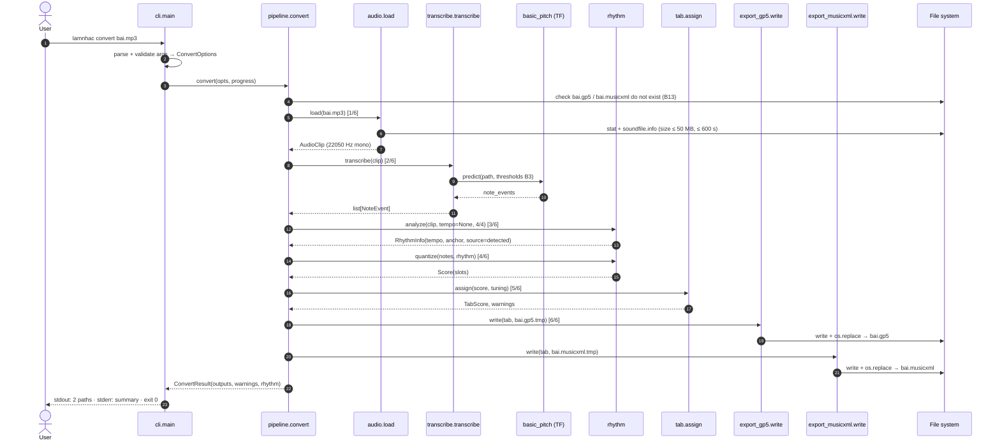
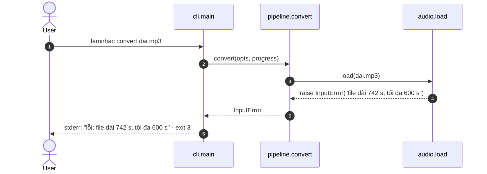
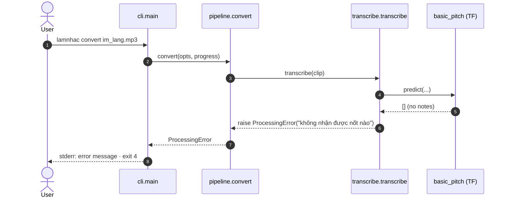
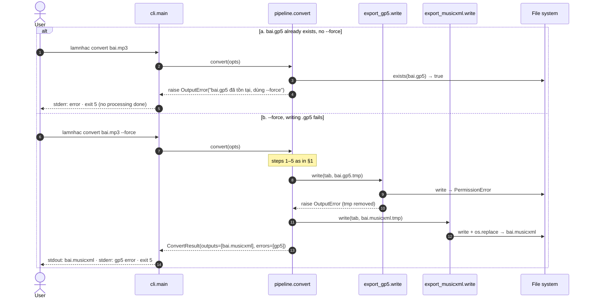

# Sequence Diagrams: MP3 → Guitar Pro

- **PRD:** [PRD-mp3-to-guitarpro](../prd/PRD-mp3-to-guitarpro.md)
- **ADR:** [0001-transcription-and-export-libraries](../adr/0001-transcription-and-export-libraries.md)
- **Spec:** [spec-mp3-to-guitarpro](../specs/spec-mp3-to-guitarpro.md)
- **Status:** Draft

## 1. Convert thành công

Người dùng chạy `lamnhac convert bai.mp3` không truyền `--tempo`. Kết quả là `bai.gp5` và `bai.musicxml`.

## 2. Đầu vào không hợp lệ

File không tồn tại, sai đuôi, lớn hơn 50 MB, dài hơn 10 phút, hoặc hỏng (B1, B2).

## 3. Không nhận được nốt nào

Ví dụ file chỉ có tiếng ồn hoặc im lặng (B4).

## 4. Đầu ra đã tồn tại, hoặc một định dạng ghi lỗi

Có hai nhánh. Nhánh a: file đã có và không truyền `--force`, nên dừng trước khi xử lý (B13). Nhánh b: có `--force`, nhưng `.gp5` ghi lỗi trong khi MusicXML vẫn ghi được (B16).

